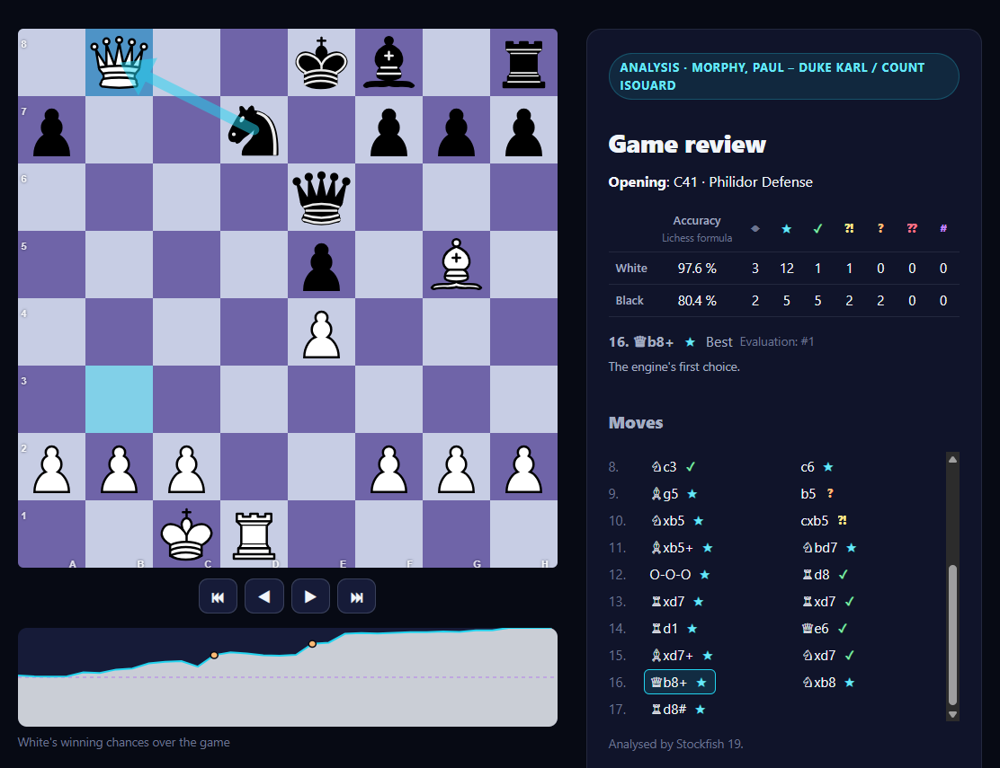

# Kopi Chess

*Open source educational project in Chess and Code.*

[Read in English](README.md)

Juega al ajedrez contra cinco bots en el navegador y después **revisa cada
partida**: cada jugada recibe un veredicto y la mejor alternativa del motor, y
la revisión señala los mates que se escaparon. Funciona en tu máquina; nada
sale de ella.



## Inicio rápido

Necesitas **Docker** con Compose (Docker Desktop en Windows y macOS), en una
máquina x86-64 o ARM64, y alrededor de 1 GB de disco.

```shell
git clone https://github.com/arquitechthor/kopi-chess.git
cd kopi-chess
docker compose up --build
```

Abre <http://localhost:8080>, elige un bot y juega. El primer arranque tarda
unos minutos (compila la aplicación); los siguientes, segundos.

## Qué hace

- **Cinco bots**, de `PAWN` (juega como un niño que acaba de aprender) a
  Stockfish a plena fuerza. Tu balance contra cada uno aparece a su lado.
- **Una revisión de cada partida terminada**, en segundo plano: veredicto de
  cada jugada (teoría, la mejor, buena, imprecisión, error, error grave, mate
  perdido), la apertura, la precisión de cada bando y una gráfica de las posibilidades
  de ganar.
- **Importar y exportar PGN**: analiza igual una partida de Lichess, de
  Chess.com o de un tablero físico, y llévate las tuyas a donde quieras.
- **Historial** de todas tus partidas, filtrado por origen y resultado.
- **Modo oficina**: la partida parece la web de una empresa cualquiera, el
  tablero es una tabla con letras (`T`, `A`, `C`…) y las jugadas se escriben
  en notación algebraica (`e4`, `Cf3`, `O-O`). Pasa desapercibido y entrena
  la notación.
- **Una API REST** para todo ello, y la interfaz en **inglés y español**.

## Aprender del código

Kopi Chess también está hecho para leerse. Es un ejemplo de referencia de:

- **Java moderno (25)**: records, *sealed interfaces*, *pattern matching*,
  hilos virtuales, *stream gatherers*, *scoped values*…
- **Spring Boot 4**
- **Arquitectura Hexagonal**: un dominio de ajedrez en Java puro (reglas
  verificadas con *perft*), casos de uso sin dependencias de *frameworks* y
  adaptadores para la interfaz web, la API REST, PostgreSQL y Stockfish. Los
  límites los comprueba ArchUnit.

Stack: Java 25 · Spring Boot 4 · Maven · PostgreSQL · Flyway · Stockfish
(UCI) · Thymeleaf · Chessground · Docker Compose · JUnit 5 · ArchUnit ·
Testcontainers.

- Por dónde empezar a leer: [`docs/arquitectura.md`](docs/arquitectura.md)
- Diseño técnico: [`docs/kopi-chess-diseno-tecnico.md`](docs/kopi-chess-diseno-tecnico.md)
- Plan de desarrollo: [`docs/kopi-chess-plan-desarrollo.md`](docs/kopi-chess-plan-desarrollo.md)
- Registros de decisiones de arquitectura (ADR): [`docs/adr/`](docs/adr/)
- Todos los cambios, versión a versión (en inglés): [`CHANGELOG.md`](CHANGELOG.md)

## Estado

✅ **1.0** ([`v1.0.0`](https://github.com/arquitechthor/kopi-chess/releases/tag/v1.0.0)):
las siete fases del plan están hechas, y cualquiera puede clonarlo, levantarlo
y usarlo. Lo que puede venir después está en
[`docs/ideas-futuro.md`](docs/ideas-futuro.md), y las tareas pequeñas para
empezar a contribuir son las
[*good first issues*](https://github.com/arquitechthor/kopi-chess/issues?q=is%3Aissue+is%3Aopen+label%3A%22good+first+issue%22).

## Ejecución

**¿El puerto 8080 está ocupado?** Usa otro: `KOPI_PORT=8090 docker compose up --build`
(PowerShell: `$env:KOPI_PORT=8090; docker compose up --build`).

**Para parar**: `docker compose down`. Las partidas se conservan;
`docker compose down -v` también las borra.

**Sin compilar**: a partir de `v0.7.0`, cada versión publica la imagen en
GitHub Container Registry, para x86-64 y ARM64. En el repositorio clonado:

```shell
KOPI_IMAGE=ghcr.io/arquitechthor/kopi-chess:1 docker compose up --no-build
```

**Con métricas**: el perfil `metrics` añade Prometheus y Grafana, con un
*dashboard* de los tiempos de los bots, los análisis y la JVM, en
<http://localhost:3000>:

```shell
docker compose --profile metrics up --build
```

Las métricas en bruto están en <http://localhost:8080/actuator/prometheus>.

**Los logs** (`docker compose logs app`) son líneas JSON, y cada línea sobre
una partida lleva su `gameId`. En texto plano: `KOPI_LOG_FORMAT= docker compose up`
(PowerShell no puede dar a una variable un valor vacío: pon la línea
`KOPI_LOG_FORMAT=` en un fichero `.env`). Toda la conversación con Stockfish:
`KOPI_UCI_LOG=DEBUG`.

**Por la API** (la versión de la partida va en `If-Match`; la respuesta
incluye la jugada del bot):

```shell
curl -i -X POST localhost:8080/api/v1/games -H "Content-Type: application/json" \
     -d '{"humanColor": "WHITE", "botProfile": "PAWN"}'
curl -X POST localhost:8080/api/v1/games/<id>/moves -H 'If-Match: "0"' \
     -H "Content-Type: application/json" -d '{"uci": "e2e4"}'
```

## Compilar desde el código fuente

Requiere **JDK 25**. No hace falta Maven: el repositorio incluye el *wrapper*.
Las pruebas de integración necesitan Docker (Testcontainers).

```shell
cd backend
./mvnw verify        # Windows: mvnw.cmd verify
```

Las pruebas lentas (los *perft* profundos, unos 15 s) no se ejecutan en local
pero sí en la CI. Para incluirlas: `./mvnw verify -Pslow-tests`.

**Durante el desarrollo**, ejecuta `TestKopiApplication` (en
`backend/kopi-bootstrap/src/test`) desde el IDE: levanta la app con un
PostgreSQL desechable mediante Testcontainers.

Si tu `JAVA_HOME` apunta a otro JDK, cámbialo solo para la terminal actual;
por ejemplo, en PowerShell: `$env:JAVA_HOME = "C:\ruta\al\jdk-25"`.

Si tu `~/.m2/settings.xml` redirige todo a un *mirror* privado no accesible,
compila con un archivo de *settings* vacío:
`./mvnw -s ruta/a/settings-vacio.xml verify`, donde el archivo solo contiene
`<settings/>`.

## Contribuir

El código, los *commits*, los *issues* y las *pull requests* van en
**inglés**. Los documentos de diseño, en **español**. Cómo preparar el
entorno, el flujo de trabajo y la definición de terminado están en
[`CONTRIBUTING.md`](CONTRIBUTING.md) (en inglés).

## Licencia

[GPL-3.0](LICENSE). Kopi Chess usa Stockfish y Chessground, ambos GPL-3.0;
consulta [`NOTICE`](NOTICE).
